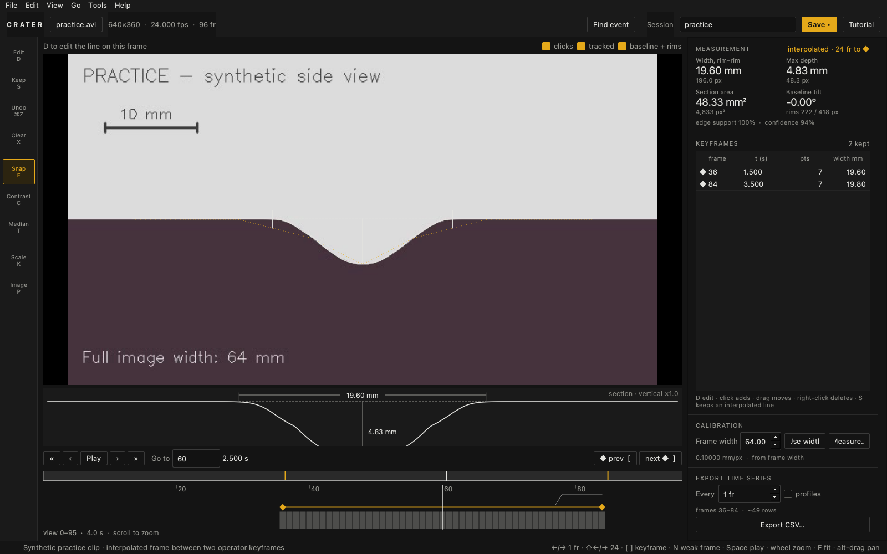
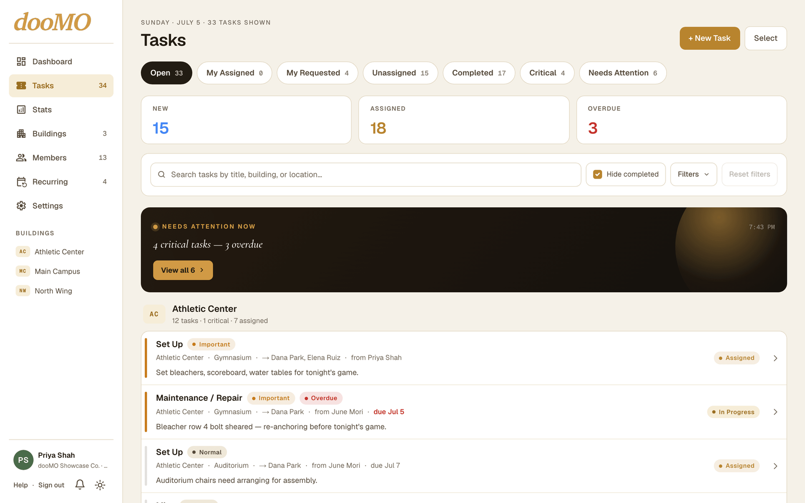
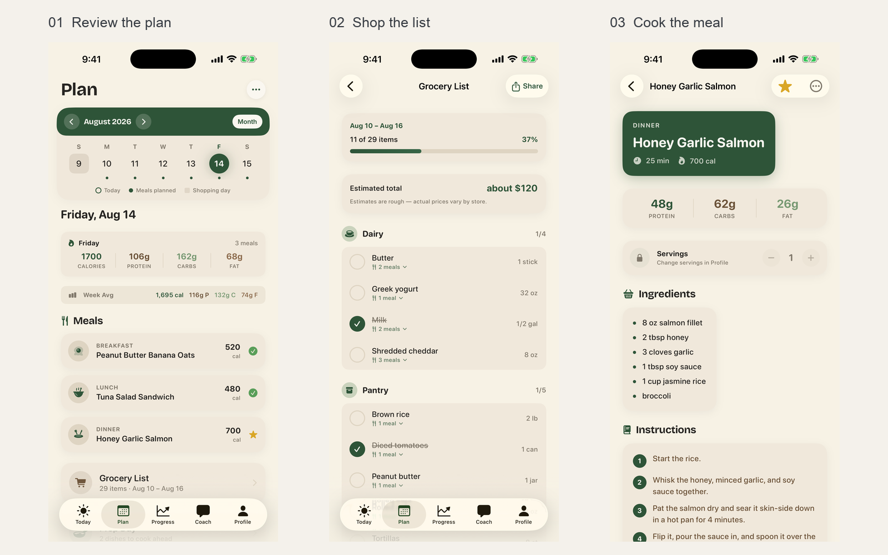
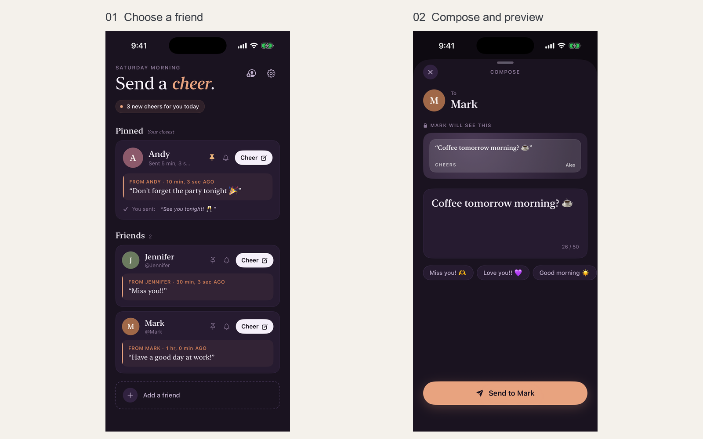

# Brayden Herzberg

**Aerospace engineering · Research software · Web & iOS development**

I study Aerospace Engineering at the University of Central Florida, with a Bioengineering minor and an expected graduation of **May 2028**. My interests span human spaceflight, EVA, bioastronautics, and the software that helps people investigate and solve engineering problems.

I develop research tools and build products through **Tributary Studios**, which I founded.

[LinkedIn](https://www.linkedin.com/in/braydenherzberg/) · [X](https://x.com/braydenherzberg) · [Tributary Studios](https://tributarystudios.com/)

## Selected projects

### Crater — research video analysis

**Research tool · Public release** 
Offline software for tracing the crater interface in side-camera footage and exporting width, depth, and cross-section area. Developed in connection with my plume–surface interaction research at UCF.

Python · PySide6 · OpenCV · NumPy 
[Case study](projects/crater.md) · [Source & downloads](https://github.com/braydenherzberg/Crater_Tracker) · [Measurement method](https://github.com/braydenherzberg/Crater_Tracker/blob/main/docs/analysis_method.md)

### dooMO — facility work orders

**Live web product · iOS in development · Source code private** 
Maintenance requests, team assignments, and completion records across buildings. As Tributary Studios' founder, I independently built the web and iOS platform.

TypeScript · Next.js · React · SwiftUI · Firebase 
[Case study](projects/doomo.md) · [Visit dooMO](https://doomotasks.com/)

### Cado — meal planning, groceries, and cooking

**Released iOS app · Source code private** 
A weekly meal plan, a combined grocery list, and recipes sized for the people eating. I developed the native app and its plan, recipe, and grocery workflows through Tributary Studios.

Swift · SwiftUI · SwiftData · Firebase Cloud Functions · StoreKit 
[Case study](projects/cado.md) · [App Store](https://apps.apple.com/us/app/cado-meal-prep-coach/id6797121303)

### Cheers — messages for a friend's lock screen

**Released iOS app · Source code private** 
Short messages shared through lock-screen and home-screen widgets. I built the native app, widget experience, and Firebase-backed messaging workflow.

Swift · SwiftUI · WidgetKit · Firebase 
[Case study](projects/cheers.md) · [App Store](https://apps.apple.com/us/app/cheers-lockscreen-widgets/id6759501004)

---

Screenshots use synthetic practice footage or fictional demonstration data. Project pages distinguish what is released, what is still in development, and what has been validated.
