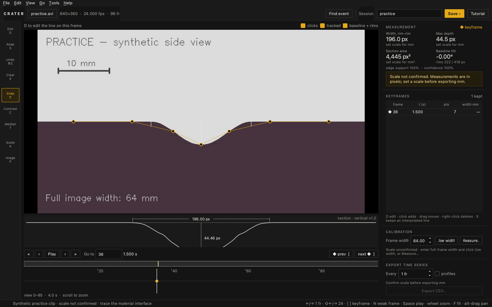
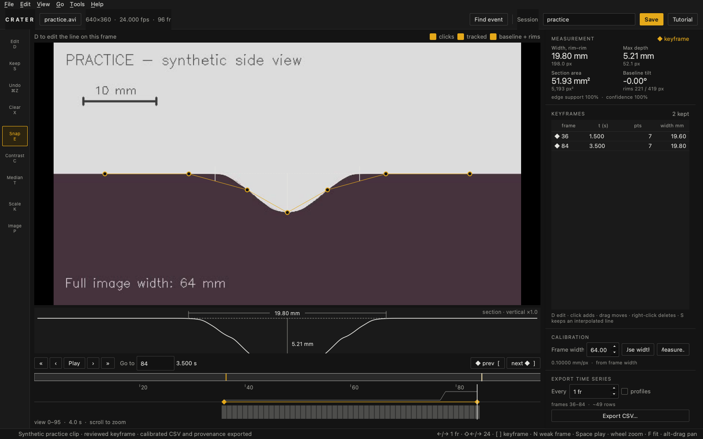

# Crater Tracker

**Research software · Public release v0.5.1**

[Source and documentation](https://github.com/braydenherzberg/Crater_Tracker) · [Downloads](https://github.com/braydenherzberg/Crater_Tracker/releases/latest) · [Measurement method](https://github.com/braydenherzberg/Crater_Tracker/blob/main/docs/analysis_method.md) · [Tracking benchmark](https://github.com/braydenherzberg/Crater_Tracker/blob/main/docs/benchmark.md)

Python desktop software for analyzing crater development in side-camera videos of plume–surface interaction experiments. Users trace the crater interface, calibrate the image, review tracking, and export width, vertical depth, and cross-section area. Video processing runs offline.

## Contributions

- Developed the application as a member of the UCF Hawking Center's Knights Research Scholar Program team, with responsibilities in nozzle design and data analysis.
- Implemented operator-guided tracing, local edge snapping, keyframe interpolation, and tracking-quality review.
- Built calibration controls, session saving, CSV export, and JSON records of analysis settings.

## Screenshots

**Trace:** Select the crater interface. Measurements remain in pixels until the scale is confirmed.

**Review:** Inspect the profile, measurements, and tracking between keyframes.

**Export:** Save measurements to CSV with calibration, keyframe, and analysis settings in a separate JSON file.

[Workflow demo](../assets/crater/demo.gif). Screenshots use the bundled synthetic practice video; displayed dimensions are practice values.

## Design decision

The operator selects the physical interface before edge snapping. Reflections, dust, and container walls can produce strong edges that are not the crater. A bounded search around the guide reduces the risk of tracking a different boundary, at the cost of manual annotation and review. The original threshold tuner remains available.

**Technologies:** Python, PySide6, OpenCV, NumPy, CSV, JSON.

## Status and validation

Version v0.5.1 has published builds for Apple silicon Macs, Intel Macs, and Windows. The local synthetic demonstration completed tracing, calibration, interpolation, session saving, and CSV/JSON export.

The [documented repeatability experiment](https://github.com/braydenherzberg/Crater_Tracker/blob/main/docs/analysis_method.md#measured-repeatability) used one frame, Mars Perfect Run 3 frame 9,191. Twelve simulated operators placed seven clicks with ±4 px random error near the same line:

| Standard deviation | Without edge snapping | With edge snapping |
| --- | --- | --- |
| Width | 50.8 px | 8.9 px |
| Depth | 4.8 px | 2.0 px |

These results measure sensitivity to click placement, **not independent physical accuracy**. Physical validation requires representative labelled frames, review of interface and rim definitions, and calibration in the crater's optical plane. Cross-section area is not volume. The confidence score is a tracking-review indicator, not an uncertainty interval.

[Back to profile](../README.md)
