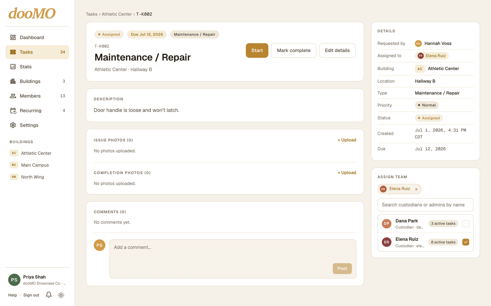
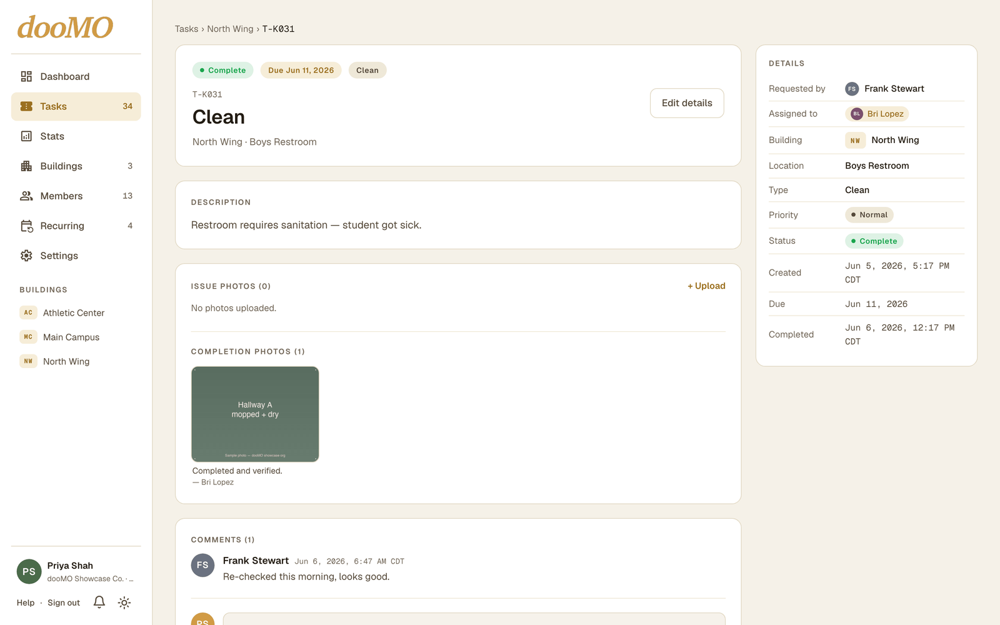

# dooMO

**Web application available · iOS in development · Source code private**

[Website](https://doomotasks.com/) · [Tributary Studios](https://tributarystudios.com/)

Facility maintenance software for schools, campuses, property managers, and other organizations with multiple buildings. Staff submit work orders, administrators assign work, and custodians update tasks and record completion.

## Contributions

- Founded Tributary Studios and independently developed dooMO's web and iOS applications.
- Built work-order submission, assignments, comments, photo records, and task status tracking.
- Implemented Firebase-backed data and API functions, role-based permissions, and building-level access controls.

## Screenshots

**Task list:** Review requests across buildings.

**Assignment:** Review the request and assign staff from the task detail.

**Completion:** Record photos, notes, comments, and completion time.

Screenshots use the product's sample organization and demonstration records. They contain no customer data.

## Design decision

Shared plan limits generate TypeScript and Swift definitions for the web and iOS clients. This requires generation and consistency checks, but reduces differences between client implementations. The backend enforces authorization separately.

**Technologies:** Next.js, React, TypeScript, Tailwind CSS, SwiftUI, Swift Charts, Firebase Authentication, Cloud Firestore, Express, Firebase Cloud Functions, Vercel.

## Status

The web application is available at [doomotasks.com](https://doomotasks.com/). The iOS application is in development and listed as coming soon on the public website. Source code is private.

[Back to profile](../README.md)
